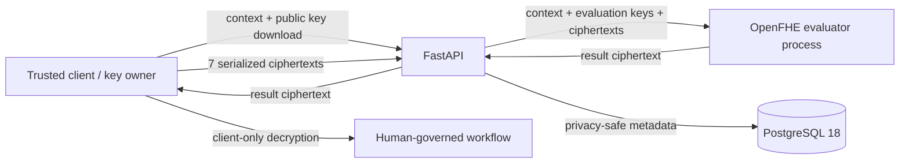

# CipherScore — Privacy-Preserving Credit Risk Pilot

CipherScore is an enterprise-oriented pilot for evaluating a seven-feature logistic-regression credit-risk model with OpenFHE CKKS. Its production contract accepts serialized ciphertexts, evaluates them in a process that has no secret key, and returns only a result ciphertext. It also provides organization- and branch-scoped application workflows, human decision governance, PostgreSQL persistence, RBAC, audit events, operational metrics, and a React administration console.

This is not a production lending system, compliance certification, fairness guarantee, or authorization for autonomous credit decisions. The model recommendation supports an authorized human decision.

## 1. Project overview

The repository contains:

- a conventional scikit-learn baseline and reproducible artifact validator;
- a split-process OpenFHE protocol (`setup`, `encrypt`, `evaluate`, `decrypt`);
- versioned FastAPI ciphertext and enterprise workflow APIs;
- PostgreSQL 18 with Alembic migrations and permission-based RBAC;
- customer and administrator React interfaces;
- measured plaintext/FHE evidence, CI, deployment, monitoring, and recovery assets.

## 2. Problem statement and motivation

Credit-risk inputs contain sensitive financial and employment information. Conventional remote inference exposes those values to the computation service. CipherScore uses CKKS to keep the seven model features encrypted during evaluator-side arithmetic, while retaining an auditable human approval workflow.

## 3. Objectives

1. Reproduce and govern the accepted ML model.
2. Keep plaintext features and the secret key outside the evaluator.
3. Preserve classification behavior within measured CKKS/polynomial error.
4. Minimize stored customer data.
5. Enforce authenticated, scoped, auditable human workflows.
6. Provide measurable operational and deployment controls for a controlled pilot.

## 4. Dataset

The source dataset has 32,581 rows and 12 columns. Exact full-row duplicates are removed before splitting. The model uses seven numerical fields: age, income, employment length, loan amount, interest rate, loan-to-income ratio, and credit-history length. `loan_status` is the binary target. Categorical fields and `loan_grade` are excluded from this first FHE-compatible model; the latter may encode underwriting information and present leakage risk.

## 5. Data preprocessing

The stratified 80/20 split uses random state 42. Median imputation and `StandardScaler` are fitted on training data only, then applied unchanged to the held-out set. `ml/artifacts/model_manifest.json` ties the dataset, feature order, split, preprocessing, model, polynomial, threshold, metrics, runtimes, and SHA-256 hashes together.

## 6. Machine learning

The accepted baseline is logistic regression with threshold profile `binary-risk-0.5-v1`. On 6,484 held-out rows it measured 83.2048% accuracy, 70.6918% precision, 39.6333% recall, 50.7908% F1, and 83.1422% ROC-AUC. The low class-1 recall is a material limitation requiring business, calibration, and fairness review.

## 7. Homomorphic encryption

OpenFHE 1.5.1 evaluates the weighted sum and a degree-7 polynomial sigmoid using CKKS. The approved profile requests 128-bit classic security, depth 6, a 50-bit scaling modulus, ring dimension 32,768, and SIMD capacity 8,192.

## 8. Why OpenFHE and CKKS?

OpenFHE provides maintained CKKS operations, serialization, evaluation-key support, and explicit cryptographic contexts. CKKS is appropriate because the standardized inputs, weights, bias, and polynomial coefficients are real-valued and tolerate bounded approximation error.

## 9. System architecture



The evaluator command receives no private-key path. Its server profile is considered unready if it contains `secret-key.bin`. The legacy `/predict` trusted-gateway endpoint exists for local research compatibility only and is forbidden by production configuration validation.

## 10. Threat model

Protected at the evaluator boundary: serialized customer feature ciphertexts and encrypted arithmetic. Protected administratively: password hashes, rotating refresh-token hashes, scoped permissions, state transitions, override reasons, and tamper-evident audit events.

Not automatically protected: a compromised client, client memory, metadata/traffic analysis, model parameters, availability attacks, malicious dependencies, database administrators, or network integrity without TLS. Production still requires SSO/MFA, managed secrets, KMS/HSM client-key custody, centralized rate limiting, endpoint protection, security monitoring, and independent review. See [docs/SECURITY.md](docs/SECURITY.md).

## 11. FHE inference protocol

1. A trusted client obtains the approved context and public key.
2. The client applies the approved imputer/scaler and encrypts seven columns.
3. `POST /api/v1/fhe/evaluate` authenticates an officer, validates the profile/batch/bounds, and invokes only `fhe_protocol evaluate`.
4. The server persists identifiers, status, evaluator latency, and ciphertext size—not feature values or a risk score.
5. The client decrypts the returned ciphertext and supplies the resulting recommendation to the governed application workflow.

See [docs/ENCRYPTED_PROTOCOL.md](docs/ENCRYPTED_PROTOCOL.md).

## 12. Experimental methodology and results

Three split-process trials packed all 6,484 held-out rows. Mean fresh-setup end-to-end latency was 6,082.27 ms: 1,201.74 ms setup, 1,651.26 ms encryption/serialization, 2,596.59 ms evaluation/serialization, and 632.68 ms decryption/deserialization. The seven-ciphertext request was 29,374,863 bytes; the response was 1,050,085 bytes.

FHE and exact-sigmoid threshold decisions differed on 0 of 6,484 rows. Mean score error versus exact sigmoid was 0.004614 and maximum error was 0.008077; this includes intentional polynomial approximation. See [benchmarks/results/split_protocol.json](benchmarks/results/split_protocol.json).

## 13. Performance analysis

The earlier in-memory FHE research batch averaged 2,343.70 ms versus 0.617 ms for normal batch inference, about 3,798.8× slower. The enterprise split-process total is larger because it includes independent processes and serialization. Fresh key generation should be amortized over an approved key lifetime, not repeated for every request.

## 14. Enterprise workflow

Organizations, branches, memberships, consent records, applications, workflow history, decisions, crypto profiles, and retention policies are normalized in PostgreSQL. Applications follow guarded transitions from `DRAFT` through prediction/review to a final human decision. Model overrides require an authorized reason. Only hashes/references and derived metadata are stored; raw financial features are absent.

## 15. Installation

Requirements: Python 3.12, Node.js 22, PostgreSQL 18, CMake, a C++17 compiler, and OpenFHE 1.5.1.

```powershell
cd "C:\PRIVACY-PRESERVING CREDIT RISK PROJECT"
python -m venv .venv
Set-ExecutionPolicy -Scope Process Bypass
& .\.venv\Scripts\Activate.ps1
python -m pip install -r requirements.txt
cd frontend
npm.cmd ci
cd ..
```

Generate/validate ML artifacts:

```powershell
python -m ml.inspect_dataset
python -m ml.preprocess
python -m ml.train
python -m ml.extract_model
python -m ml.polynomial
python -m ml.validate_artifacts
```

The PostgreSQL setup has a masked, idempotent Windows helper. Run it only for a new/unconfigured installation—not on an already configured database:

```powershell
& .\scripts\setup-postgresql.ps1
```

Never send passwords through chat or commit `.env`.

## 16. Usage in VS Code

Backend terminal:

```powershell
cd "C:\PRIVACY-PRESERVING CREDIT RISK PROJECT"
& .\.venv\Scripts\Activate.ps1
python -m uvicorn backend.app.main:app --host 127.0.0.1 --port 8001 --reload
```

Frontend terminal:

```powershell
cd "C:\PRIVACY-PRESERVING CREDIT RISK PROJECT\frontend"
$env:VITE_API_URL="http://127.0.0.1:8001"
npm.cmd run dev
```

Open `http://127.0.0.1:5173`. The backend root returning 404 is normal; use `/health`, `/api/v1/system/liveness`, `/api/v1/system/readiness`, or `/docs`.

## 17. Administrator sign-in

Open `/admin/login` through the customer-site **Admin Login** link. Use the administrator account created during secure bootstrap—not the PostgreSQL role/password. Successful login redirects to `/admin`; unauthenticated protected routes return to `/admin/login`. Credentials are intentionally absent from this repository.

## 18. Testing

```powershell
python -m pytest -q
cd frontend
npm.cmd run lint
npm.cmd test
npm.cmd run build
```

The native protocol benchmark is:

```powershell
python -m benchmarks.benchmark_protocol --runs 3
```

CI reproduces ML artifacts, validates PostgreSQL migrations, runs backend/frontend checks, and builds Linux-native OpenFHE containers. The k6 harness is in `tests/load`.

## 19. Deployment

`compose.yaml` defines PostgreSQL, Redis, the API, frontend, TLS edge proxy, and Prometheus on segmented networks. The backend image compiles OpenFHE for Linux and mounts only a read-only public/evaluation profile. Docker secrets supply the database URL, JWT key, metrics token, PostgreSQL password, and Redis ACL. See [deployment/README.md](deployment/README.md) and [docs/BACKUP_AND_RECOVERY.md](docs/BACKUP_AND_RECOVERY.md).

## 20. Limitations

- No audited browser OpenFHE/WASM client is shipped; a separate trusted client is required.
- Key rotation/recovery/HSM integration, SSO/MFA, distributed quotas, Redis-backed queues, and policy-driven retention execution require institutional integration.
- The dataset is limited, historical, imbalanced, and not demonstrated representative of a deployment population.
- No calibration, subgroup fairness, drift, adversarial robustness, or legal validation has been completed.
- CKKS and the sigmoid polynomial are approximate; scores can slightly leave `[0,1]` before trusted-client presentation handling.
- Docker/k6 live acceptance was not run on this workstation because those executables are unavailable.

See [docs/LIMITATIONS.md](docs/LIMITATIONS.md).

## 21. Future work

Priorities are an audited client SDK, managed client-key lifecycle, asynchronous Redis-backed FHE jobs, OIDC/MFA, organization-configured retention enforcement, calibration/fairness/drift studies, load/capacity testing on target hardware, SBOM/image signing, and independent penetration/cryptographic review.

## 22. Conclusion

CipherScore demonstrates a genuine ciphertext-only OpenFHE evaluator boundary and preserves every held-out threshold decision in the measured experiment. It also establishes the data, authorization, audit, workflow, observability, and deployment foundation for a controlled pilot. It must not be represented as production-ready lending software until the explicit acceptance gaps are closed.
