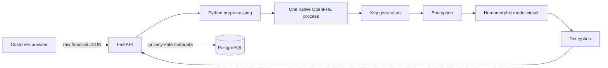

# Enterprise Upgrade Gap Analysis

Date: 2026-08-07  
Scope: 144 release-source files, local runtime/build artifacts excluded

## Baseline

- Backend/ML/FHE/documentation suite: **28 passed**.
- Frontend baseline: Vitest fork worker timed out before loading tests; this is an execution-infrastructure failure, not an assertion result. Lint/build must be rerun after stabilizing the worker configuration.
- PostgreSQL: SQLAlchemy 2, psycopg 3, Alembic revisions `0001`–`0005`, 18 application tables.
- Cryptography: real OpenFHE CKKS weighted-sum and degree-7 polynomial evaluation.
- Model: seven-feature logistic regression with training-fitted imputer/scaler and measured FHE equivalence.

## Current architecture

The evaluator performs genuine homomorphic arithmetic, but the architecture is a trusted-gateway prototype. Raw fields enter FastAPI, preprocessing occurs server-side, temporary scaled values exist on the server, and key-owner/evaluator responsibilities share one process.

## What already works

- Customer prediction UI and professional protected administration UI.
- Strict Pydantic ranges for the seven research features.
- Training-only preprocessing artifacts and reproducible model exports.
- CKKS encoding, encryption, weighted sum, polynomial sigmoid, decryption, SIMD test-batch benchmark.
- Measured plaintext/FHE agreement and stage timing artifacts.
- PostgreSQL connection hardening, migrations, metadata/FHE metric persistence.
- JWT access tokens, Argon2id, hashed rotating refresh tokens, revocation, lockout, rate limiting.
- Permission-based RBAC, audit hash chain, security events, model governance, reports, notifications, health views.
- Masked/idempotent PostgreSQL bootstrap and secret-redacted native command handling.
- Documentation of the prototype trust boundary and measured limitations.

## Partial enterprise capabilities

| Capability | Current state | Gap |
|---|---|---|
| RBAC | Permission-based roles exist | Missing institution/branch scopes and enterprise role templates |
| Model registry | Version/status/metrics exist | Missing schema checksum, organization binding, threshold version, training metadata |
| Benchmarking | Real full-batch CKKS metrics | Missing batch matrix, peak memory/CPU, serialization/network timings |
| Audit | Hash-chained safe events | Missing first-class correlation ID column and broader prediction/workflow events |
| Health | Public and admin health | Missing separate liveness/readiness and dependency latency |
| Configuration | `.env` and admin settings | Missing unified application modes and startup production validation |
| Reporting | Safe aggregate JSON/CSV concepts | Missing institutional/branch/application reports and generated files |
| UI | Strong monitoring/admin shell | Missing loan application/workflow and institution administration screens |
| Deployment | Local Windows documentation | Missing containers, Nginx, CI, backup automation, pilot topology |

## Critical privacy gaps

1. `POST /predict` accepts `CreditRiskRequest` with raw income, loan, employment, interest, ratio, age, and credit-history values.
2. `backend/app/service.py` performs imputation/scaling on the computation server.
3. Scaled plaintext is written to a server-side temporary CSV.
4. `day3_fhe_predict.cpp` generates the secret key and decrypts in the same process that evaluates.
5. No OpenFHE context/key/ciphertext serialization contract exists between client and evaluator.
6. The server cannot prove it never possessed the client secret key.
7. The plaintext endpoint is always enabled; no production-mode gate exists.

## Security and operational gaps

- No request-body size middleware or ciphertext-specific payload limits.
- No versioned enterprise API contract.
- No `/liveness` and dependency-aware `/readiness` separation.
- No structured JSON logging/correlation context or central log redaction filter.
- CORS is fixed for local development rather than validated configuration.
- Rate limiting is per process and unsuitable for horizontally scaled deployment.
- No password reset/MFA/session-device management; only future intent is documented.
- No Redis/worker queue, backpressure, queue status, or resource isolation.
- No Docker, Nginx, TLS reference, CI, vulnerability/secret scanning, or backup scripts.
- No production configuration fail-fast policy.

## Business and governance gaps

- No organization, branch, loan product, application, workflow history, human decision, note, or override entity.
- Prediction and human lending decision are not modeled as separate records.
- Binary LOW/HIGH threshold is hardcoded rather than versioned/configurable.
- No application ownership/branch authorization constraints.
- No retention/anonymization execution path.
- No outcome feedback, calibration monitoring, or fairness tooling.

## Scalability and performance gaps

- Each API request launches a heavy native process synchronously.
- No concurrency cap, worker pool, queue, or cancellation/status endpoint.
- No single-versus-batch benchmark matrix.
- No peak memory, CPU, serialization, deserialization, or payload-transfer measurement.
- Frontend dashboard bundle contains a large chart chunk and some API logic remains embedded in components.

## Regression-sensitive areas

- Seven-feature order and training-fitted preprocessing artifacts.
- Degree-7 polynomial coefficients and `0.5` research threshold.
- OpenFHE executable/DLL discovery on Windows.
- Existing administrator permissions and Alembic history.
- Privacy-safe persistence: raw fields must not enter new tables.
- Existing `/predict` clients; it should become an explicitly gated compatibility endpoint, not silently change semantics.

## Prioritized implementation

### P0 — required for the privacy claim

1. Define versioned crypto/model/profile manifests with strict hashes and limits.
2. Split native commands into trusted client operations and ciphertext-only evaluator operation.
3. Serialize context/public/evaluation keys and ciphertexts; never transmit/serialize the secret key to the server.
4. Add `/api/v1/predictions/encrypted` and encrypted result contract.
5. Add an automated E2E test proving server inputs contain no raw fields/secret key and decrypted output matches plaintext tolerance.
6. Gate legacy plaintext `/predict` off in production mode.

### P1 — pilot security and governance

1. Unified validated configuration, production-mode checks, request limits, structured/redacted logging, readiness/liveness.
2. Organization and branch scope; permission templates for institution administrators, managers, officers, analysts, and auditors.
3. Loan application/workflow, prediction request/result, human decision/note/override history.
4. Correlation-aware audit events and security failures.
5. Configurable/versioned risk thresholds and model/feature/profile traceability.

### P2 — operability

1. Dedicated OpenFHE worker interface with bounded concurrency/status; Redis queue only when deployment requires multiple workers.
2. Prometheus-compatible metrics, benchmark resource measurements, load tests.
3. Docker multi-stage builds, Compose staging profile, Nginx, backup/restore scripts, CI/security checks.
4. Enterprise application/workflow UI and technical privacy dashboard.

### P3 — model readiness

1. Validation split, PR-AUC, Brier/calibration, FPR/FNR, reproducible model comparison.
2. Authorized institutional retraining/validation workflow.
3. Legally approved fairness evaluation and outcome feedback architecture.

## Acceptance interpretation

System readiness and model readiness are separate. Completing software controls does not make a public-dataset model suitable for lending. Enterprise completion requires the P0 ciphertext-only flow to be implemented and verified with real OpenFHE serialization; interface placeholders or mock cryptography do not satisfy acceptance.
