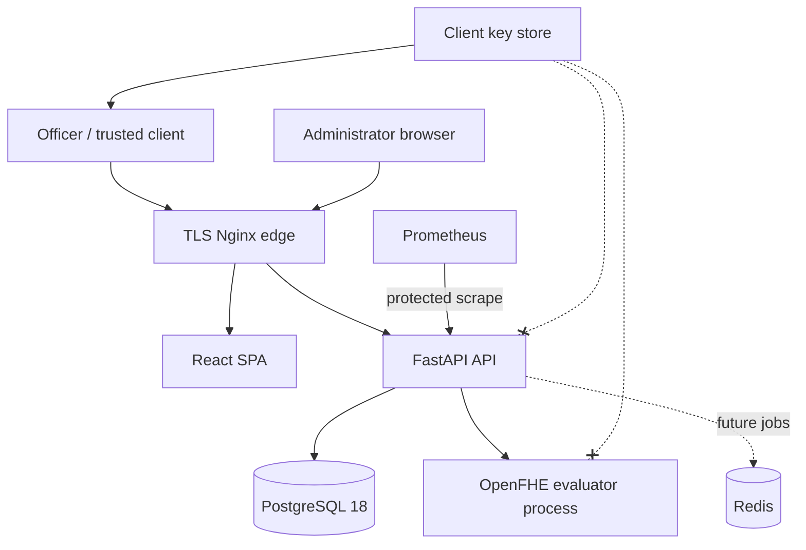

# Project architecture

## Runtime components

The trusted client downloads context/public-key material, applies approved preprocessing, encrypts seven features, submits ciphertexts, and decrypts the returned ciphertext. FastAPI authenticates, validates, persists minimized metadata, and launches only the evaluator command. The evaluator loads context/evaluation keys and ciphertexts; it is not passed a secret-key path.

## Application layers

- `ml`: deterministic analysis, preprocessing, training, extraction, polynomial selection, and artifact validation.
- `openfhe`: approved model constants and independent setup/encrypt/evaluate/decrypt native commands.
- `backend.app`: configuration, middleware, probes, encrypted contract, compatibility service, and enterprise workflow.
- `backend.app.admin`: authentication, authorization, audit, dashboards, governance, and operational APIs.
- `frontend`: customer entry and a protected permission-filtered enterprise console.
- `backend.migrations`: PostgreSQL schema ownership through Alembic; production never uses `create_all`.
- `deployment`: Linux native build, containers, TLS proxy, networks, secrets, and monitoring.

## Data flow and persistence

Production ciphertexts exist only in request memory and isolated temporary files removed after evaluation. PostgreSQL stores prediction/application/organization/branch references, requesting user, model/profile, status, evaluator timing, and ciphertext size. It does not store ciphertext payloads, raw financial features, or a decrypted result. Human decisions are separate from model recommendations.

## Scalability boundary

The pilot evaluator is synchronous and resource intensive. Request limits and timeouts bound individual work, but multi-worker scale requires a Redis-backed admission queue, idempotency/cancellation, shared rate limits, and concurrency based on target-host memory measurements. Redis is deployment-ready but is not represented as an implemented queue.

## Availability and recovery

Liveness is process-only. Readiness checks PostgreSQL/native evaluation and requires the encrypted profile in production. High availability, PostgreSQL replication/PITR, multi-zone placement, and measured failover remain deployment decisions. See `docs/BACKUP_AND_RECOVERY.md`.
